# Sprawozdanie 1 – Architektura WordPressa i motyw od zera

**Sklep:** CyberTarcza – produkty do cyberbezpieczeństwa (klucze FIDO2, szyfrowane nośniki, akcesoria do ochrony prywatności, szkolenia)
**Repozytorium:** https://github.com/Mateuszl28/CMS_ANS (tag `lab1`)
**Motyw:** `wp-content/themes/cybertarcza-theme` · **pluginy zespołu:** `cybertarcza-sheets`, `cybertarcza-ai`

---

## Odpowiedzi na pytania

### 1. Który plik szablonu wybrał WordPress dla strony głównej, wpisu i nieistniejącego adresu? Dlaczego właśnie ten?

| Widok | Adres | Hierarchia sprawdzana przez WordPress (Query Monitor → Template) | Wybrany plik |
|---|---|---|---|
| Strona główna | `/` | **front-page.php** → page-strona-glowna.php → page-15.php → page.php → singular.php → index.php | `front-page.php` |
| Wpis | `/post-3/` | single-post-post-3.php → single-post.php → **single.php** → singular.php → index.php | `single.php` |
| Nieistniejący adres | `/ta-strona-nie-istnieje/` | **404.php** → index.php | `404.php` |
| Strona (page) | `/o-nas/` | page-o-nas.php → page-17.php → **page.php** → singular.php → index.php | `page.php` |
| Lista wpisów (Blog) | `/blog/` | home.php → **index.php** | `index.php` |

WordPress sprawdza pliki od najbardziej szczegółowego do najogólniejszego i bierze **pierwszy, który istnieje** w motywie:
- **Strona główna:** w ustawieniach jest strona statyczna „Strona główna” (ID 15). Dla strony głównej WordPress najpierw szuka `front-page.php`. Ten plik jest w motywie, więc szablony strony (`page-…`, `page.php`) nie są już brane pod uwagę.
- **Wpis:** nie ma `single-post-post-3.php` ani `single-post.php`, więc wybrany zostaje kolejny plik w hierarchii, czyli `single.php`.
- **404:** zapytanie nie zwróciło żadnej treści (`is_404()`), więc WordPress szuka `404.php` i go znajduje.
- **Blog:** dla strony z wpisami WordPress sprawdza `home.php`. Tego pliku nie ma, więc używa szablonu awaryjnego `index.php`. Jest to dowód, że `index.php` działa jako ostatnia deska ratunku.


*Rys. 1. Strona główna – Query Monitor: Template File = front-page.php*

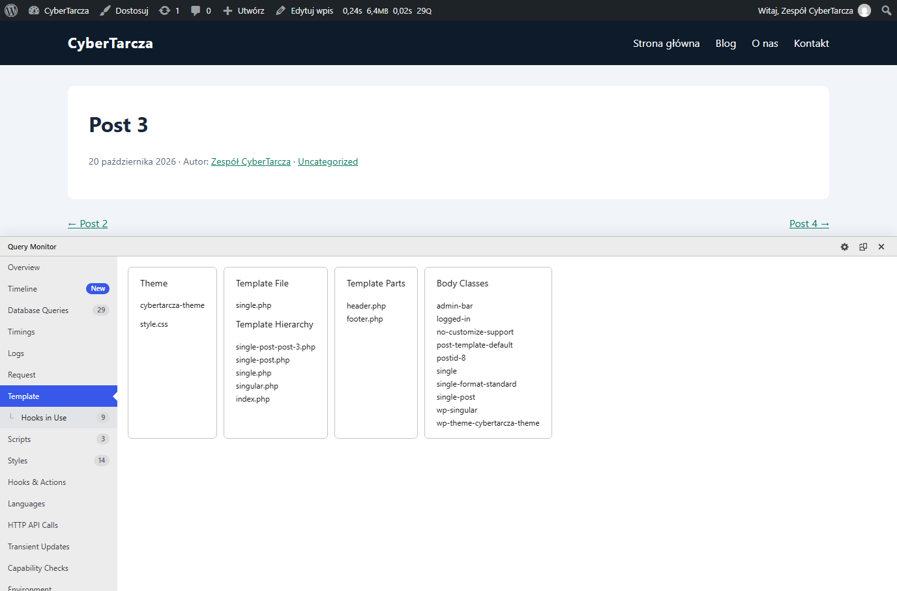
*Rys. 2. Wpis – Template File = single.php (brak single-post-post-3.php i single-post.php)*

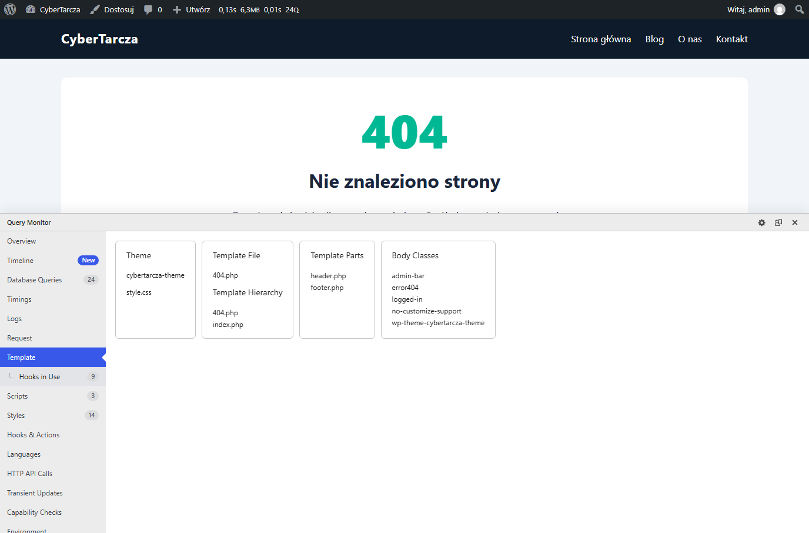
*Rys. 3. Nieistniejący adres – Template File = 404.php*

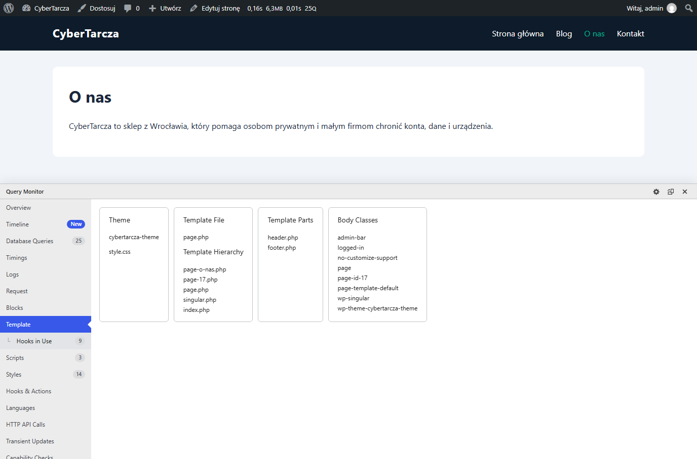
*Rys. 4. Strona „O nas” – page.php*

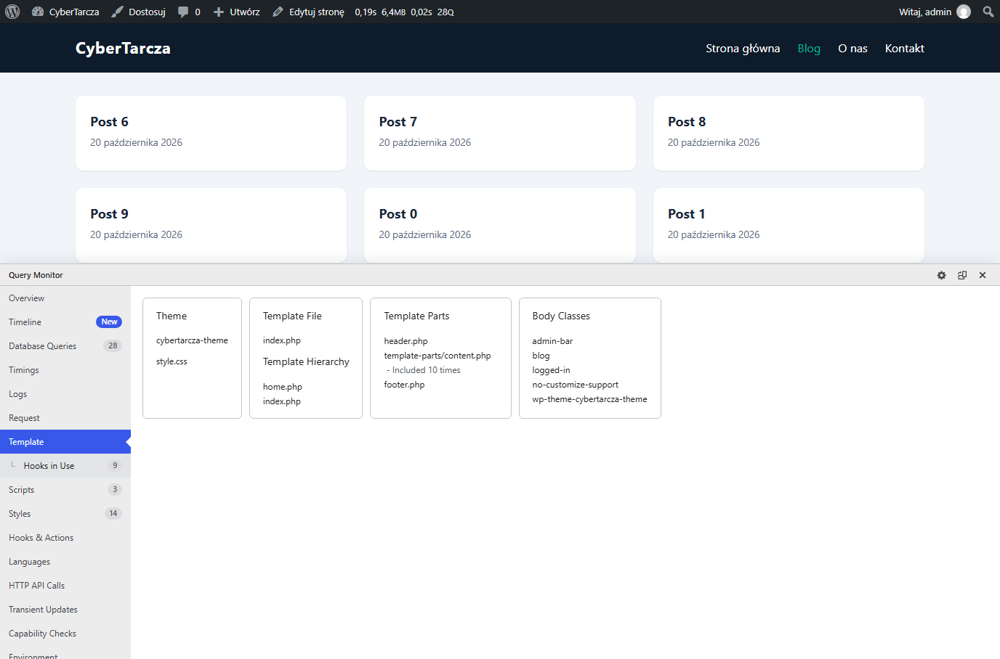
*Rys. 5. Blog – brak home.php, więc użyty został index.php*

### 2. Czym różni się akcja od filtra? Przykłady z naszego kodu

- **Akcja** (`add_action`) mówi WordPressowi: „w tym momencie wykonaj moją funkcję”. Funkcja coś robi, np. rejestruje menu albo kolejkuje plik, i **niczego nie zwraca**.
- **Filtr** (`add_filter`) mówi: „przepuść tę wartość przez moją funkcję”. Funkcja dostaje wartość, może ją zmienić i **musi ją zwrócić**. Bez `return` wartość znika, np. zajawka byłaby pusta.

Akcja z naszego kodu, `inc/assets.php`, kolejkuje CSS i JS motywu w momencie `wp_enqueue_scripts`:
```php
function cybertarcza_assets(): void {
	$ver = wp_get_theme()->get( 'Version' );
	wp_enqueue_style( 'cybertarcza-main', get_theme_file_uri( 'assets/css/main.css' ), array(), $ver );
	wp_enqueue_script( 'cybertarcza-main', get_theme_file_uri( 'assets/js/main.js' ), array(), $ver, array( 'strategy' => 'defer' ) );
}
add_action( 'wp_enqueue_scripts', 'cybertarcza_assets' );
```
Inne akcje w motywie: `after_setup_theme` (`cybertarcza_setup`, menu i obsługa funkcji motywu) oraz `widgets_init` (`cybertarcza_widgets`, obszar widgetów w stopce).

Filtr z naszego kodu, `inc/filters.php`, zmienia długość zajawki z 55 na 20 słów:
```php
function cybertarcza_excerpt_length( int $length ): int {
	return 20;
}
add_filter( 'excerpt_length', 'cybertarcza_excerpt_length' );
```
Drugi filtr, `excerpt_more`, zamienia „[…]” na „…”.

### 3. Co się stanie, jeśli w motywie zabraknie `wp_head()` lub `wp_footer()`?

Sprawdziliśmy to, tymczasowo komentując wywołanie w `header.php` lub `footer.php`. Po teście pliki zostały przywrócone.

**Bez `wp_head()`:**

| Element | Z `wp_head()` | Bez `wp_head()` |
|---|---|---|
| `<title>` strony | „CyberTarcza – Sprzęt i wiedza…” | **pusty** (`add_theme_support('title-tag')` drukuje tytuł właśnie w `wp_head`) |
| Arkusz motywu `main.css` | załadowany | **brak**, strona bez stylów |
| Skrypt motywu `main.js` | załadowany | **brak** (klasa `js` nie jest dodawana do `<html>`) |
| Arkusze `<link rel=stylesheet>` | 4 | 3 |
| Skrypty `<script src>` | 6 | 3 |

Strona wyświetla się jako „goły” HTML: menu jest listą punktowaną, brak kolorów i układu (rys. 6). Nie działa nic, co pluginy dopisują do `<head>`: style i skrypty WooCommerce, meta SEO, favicon (site icon), link kanoniczny i REST API. **`wp_enqueue_style()` nie zadziała bez `wp_head()`**, bo to właśnie ta funkcja drukuje zakolejkowane pliki.

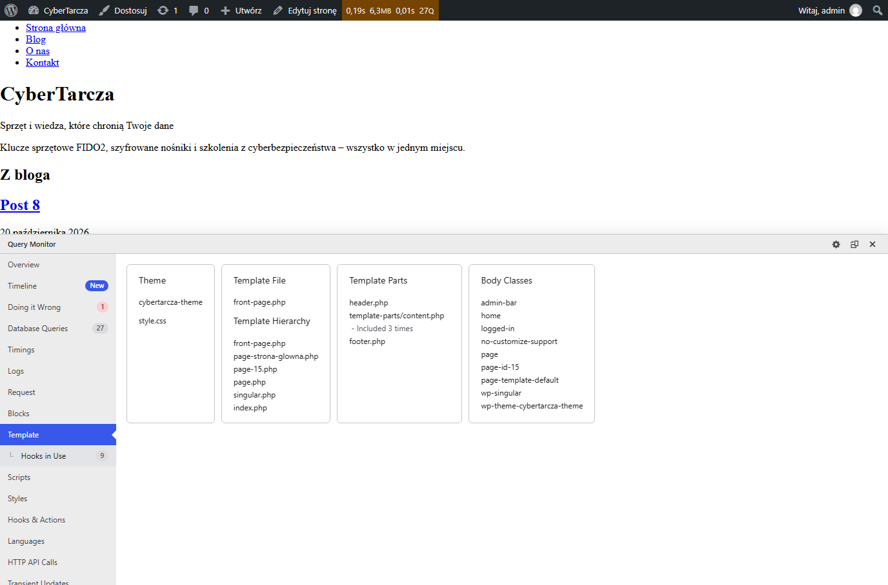
*Rys. 6. Strona główna bez wp_head(): brak CSS motywu i brak tytułu w karcie przeglądarki*

**Bez `wp_footer()`:** strona wygląda prawie tak samo (rys. 7), bo nasz CSS i JS ładują się w `<head>`. Z kodu strony znikają jednak elementy drukowane w stopce:
- `admin-bar.js` i `hoverintent-js`: pasek admina jest widoczny (od WP 5.4 drukuje go `wp_body_open()`), ale **nie działają rozwijane menu** paska;
- skrypt emoji (`wp-emoji-settings`) i moduły JS (`script type=module`);
- style bloków drukowane „na końcu” (`global-styles-inline-css`, `core-block-supports-inline-css`, `wp-block-heading`, `wp-block-paragraph`): bloki w treści tracą część formatowania;
- dane Query Monitora (`query-monitor-inline-data`);
- każdy skrypt zakolejkowany z parametrem `in_footer = true`, np. koszyk WooCommerce, który doczytuje się przez AJAX.

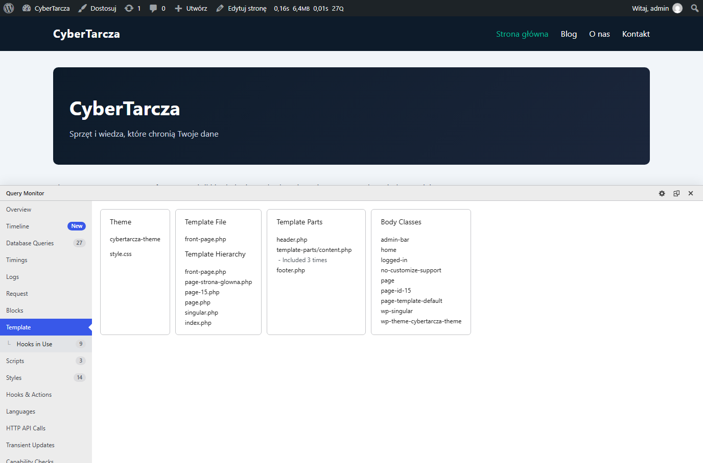
*Rys. 7. Bez wp_footer(): wygląd prawie bez zmian, ale znikają skrypty stopki*

**Wniosek:** obie funkcje to „gniazda”, do których WordPress i pluginy podłączają swój kod. Bez nich motyw psuje działanie pluginów, a nie tylko własny wygląd.

### 4. Po co jest `wp_reset_postdata()`? Co się dzieje bez tego wywołania?

`$latest->the_post()` w pętli własnego `WP_Query` **nadpisuje globalną zmienną `$post`**, czyli „bieżący wpis”. Po pętli `$post` wskazuje na ostatni wpis z bloga, a nie na stronę, którą wyświetlamy. `wp_reset_postdata()` przywraca `$post` z głównego zapytania.

Test: za sekcją „Z bloga” w `front-page.php` tymczasowo wypisaliśmy `the_title()` i `the_ID()`:

| Wariant | Wynik |
|---|---|
| z `wp_reset_postdata()` | „Globalny $post po pętli: **Strona główna (ID 15)**”, czyli poprawnie |
| bez `wp_reset_postdata()` | „Globalny $post po pętli: **Post 7 (ID 12)**”, czyli ostatni wpis z WP_Query |

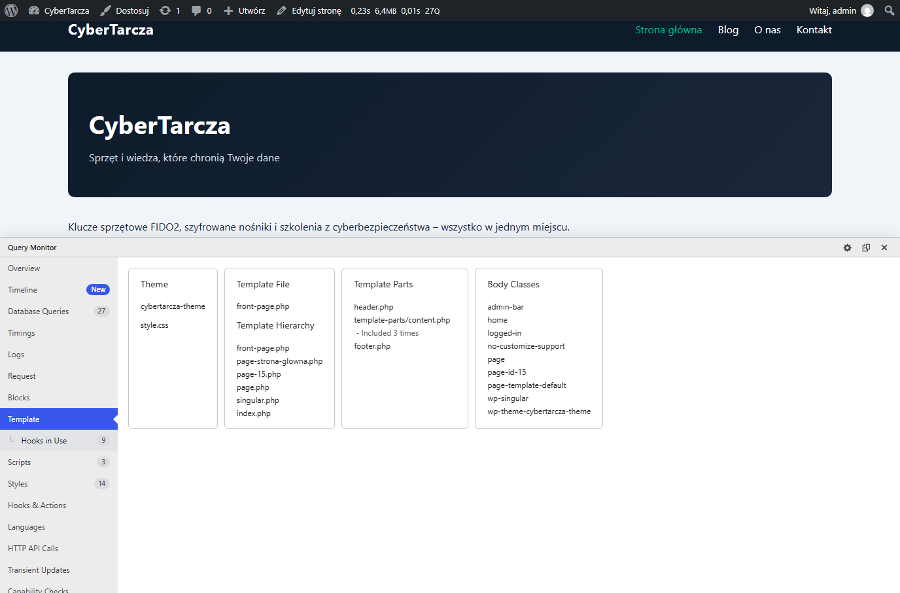
*Rys. 8. Z wp_reset_postdata(): po pętli bieżącą treścią jest znów strona główna*


*Rys. 9. Bez wp_reset_postdata(): kod za pętlą „myśli”, że wyświetla Post 7*

Bez resetu każdy kod wykonany po pętli działa na złym obiekcie. Pola ACF strony głównej (`get_field()` bez ID, zajęcia 2) zwróciłyby dane wpisu „Post 7”. Tytuł, `the_content()`, link „Edytuj” i warunki `is_page()` też dotyczyłyby wpisu, a nie strony. Dlatego `wp_reset_postdata()` wywołujemy **zawsze po własnym `WP_Query`**.

---

## 1. Środowisko

| Składnik | Wymaganie | Wybrano |
|---|---|---|
| LocalWP | – | 10.2.0 |
| PHP | 8.2 lub nowszy | **8.5.1** |
| Serwer WWW | nginx | **nginx 1.26.1** |
| Baza danych | MySQL 8 | **MySQL 8.4.0** |
| WordPress | – | 7.1.3 (pl_PL) |

| | |
|---|---|
| 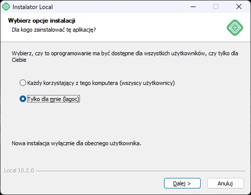 | 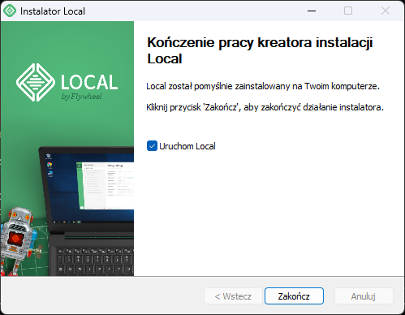 |
| Rys. 10. Instalacja Local – zakres | Rys. 11. Koniec instalacji |
| 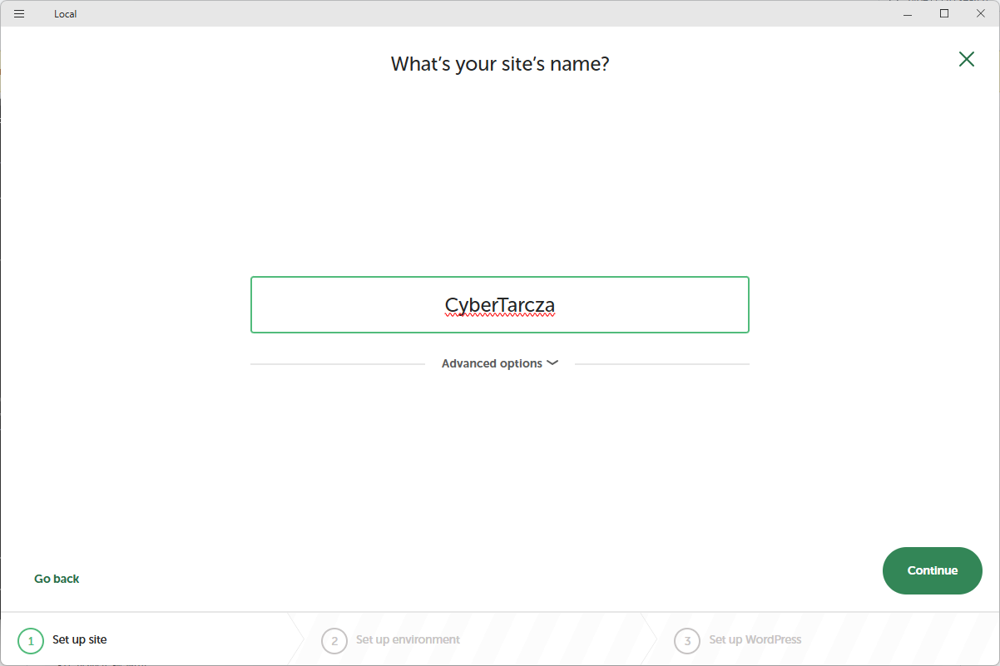 | 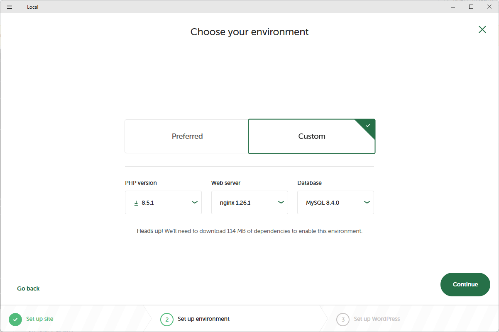 |
| Rys. 12. Nazwa strony = nazwa sklepu | Rys. 13. Środowisko Custom: PHP 8.5.1, nginx, MySQL 8.4 |

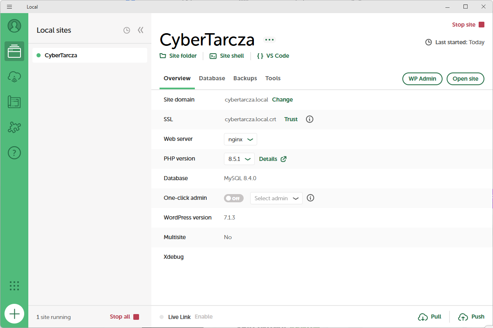
*Rys. 14. Strona CyberTarcza w Local*

W `wp-config.php` dodano stałe debugowania (`WP_DEBUG`, `WP_DEBUG_LOG`, `WP_DEBUG_DISPLAY`, `SCRIPT_DEBUG`, `WP_ENVIRONMENT_TYPE`). Przez WP-CLI zainstalowano Query Monitor i ACF (oba aktywne) oraz WooCommerce (nieaktywny), a także usunięto przykładowe treści.

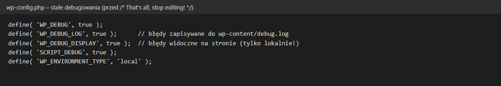
*Rys. 15. Stałe debugowania w wp-config.php*

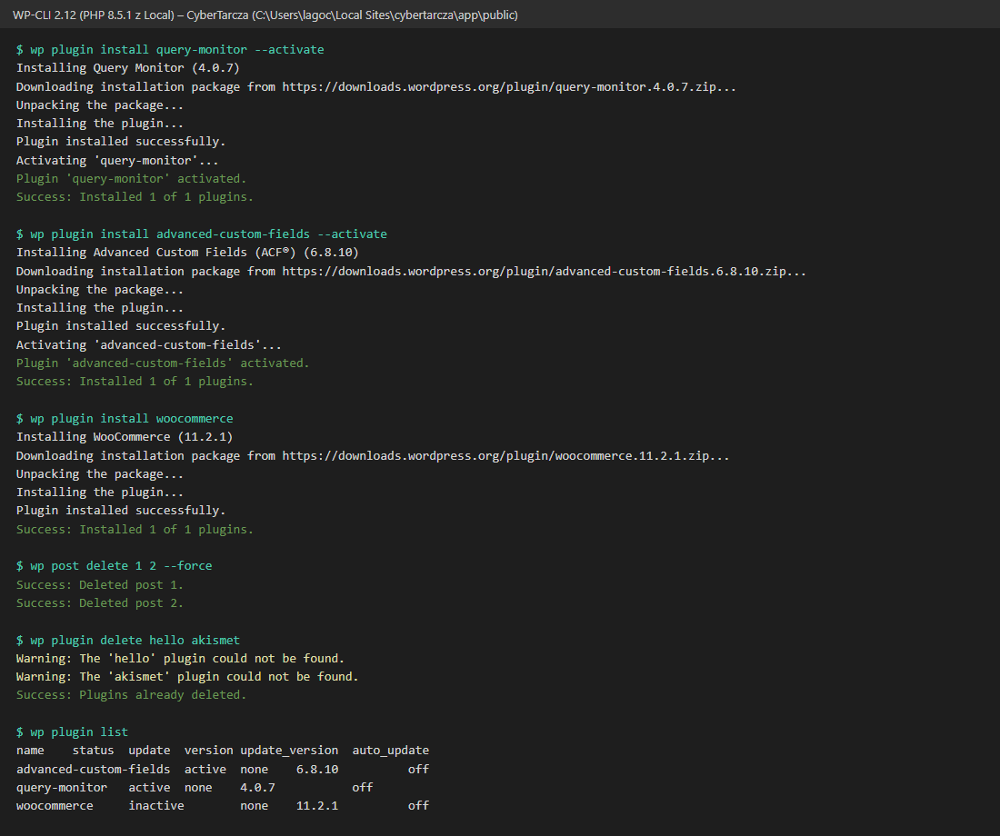
*Rys. 16. Pluginy narzędziowe zainstalowane przez WP-CLI*

Po wykonaniu wszystkich testów `debug.log` nie zawiera ostrzeżeń ani błędów z plików motywu. Jedyne wpisy to komunikaty `Deprecated` samego WP-CLI 2.12 uruchamianego na PHP 8.5.

---

## 2. Motyw `cybertarcza-theme`

```
cybertarcza-theme/
├── style.css            nagłówek motywu (Theme Name, Version, Requires PHP, Text Domain)
├── functions.php        tylko dołącza moduły z inc/
├── index.php            szablon awaryjny – pętla + get_template_part()
├── header.php           wp_head(), logo/custom-logo, menu główne
├── footer.php           obszar widgetów footer-1, menu w stopce, wp_footer()
├── front-page.php       hero + treść strony + 3 ostatnie wpisy (własne WP_Query)
├── single.php           pełna treść, data, autor, kategorie, tagi, nawigacja
├── page.php             strona statyczna
├── 404.php              komunikat + get_search_form()
├── screenshot.png       1200×900 – miniatura w panelu
├── inc/
│   ├── setup.php        after_setup_theme: title-tag, thumbnails, html5, custom-logo, woocommerce, menu
│   ├── assets.php       wp_enqueue_scripts: main.css, main.js (defer)
│   ├── widgets.php      widgets_init: obszar „Stopka”
│   ├── template-tags.php cybertarcza_post_meta() – data, autor, kategorie
│   └── filters.php      excerpt_length, excerpt_more
├── template-parts/
│   └── content.php      karta wpisu
└── assets/css/main.css, assets/js/main.js
```

Wszystkie funkcje mają prefiks `cybertarcza_`, a każdy plik PHP zaczyna się blokadą `if ( ! defined( 'ABSPATH' ) ) exit;`. Dane wyjściowe są escapowane (`esc_html`, `esc_url`, `esc_attr`, `wp_kses_post`).

**Treści testowe (WP-CLI):** `wp post generate --count=10`, strony „Strona główna” (ustawiona jako strona główna), „Blog” (strona wpisów), „O nas”, „Kontakt” i „Regulamin”. Utworzono menu „Menu główne” (lokalizacja primary) i „Menu w stopce” (footer) oraz 2 widgety w obszarze „Stopka”. Język witryny: polski, strefa czasowa Europe/Warsaw.

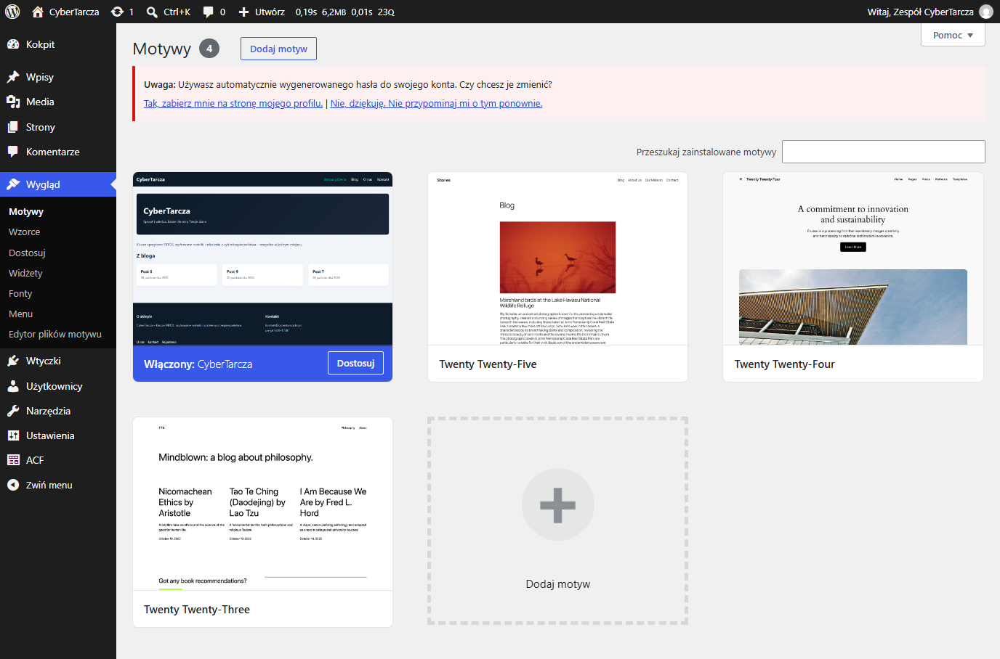
*Rys. 17. Wygląd → Motywy: aktywny motyw CyberTarcza z miniaturą screenshot.png*

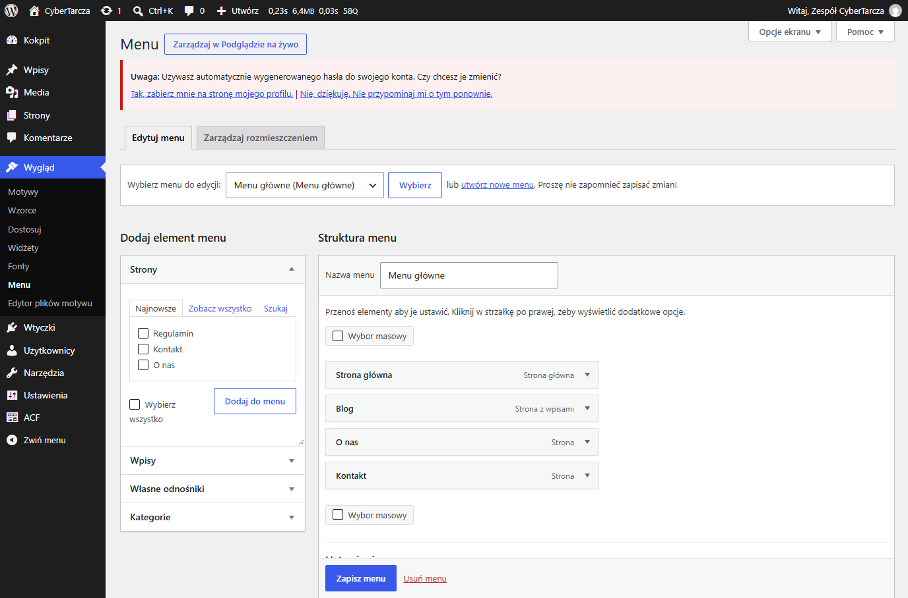
*Rys. 18. Menu główne i menu w stopce*

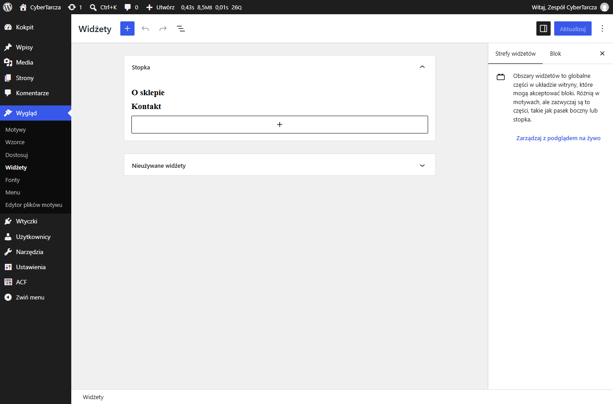
*Rys. 19. Obszar widgetów „Stopka”*

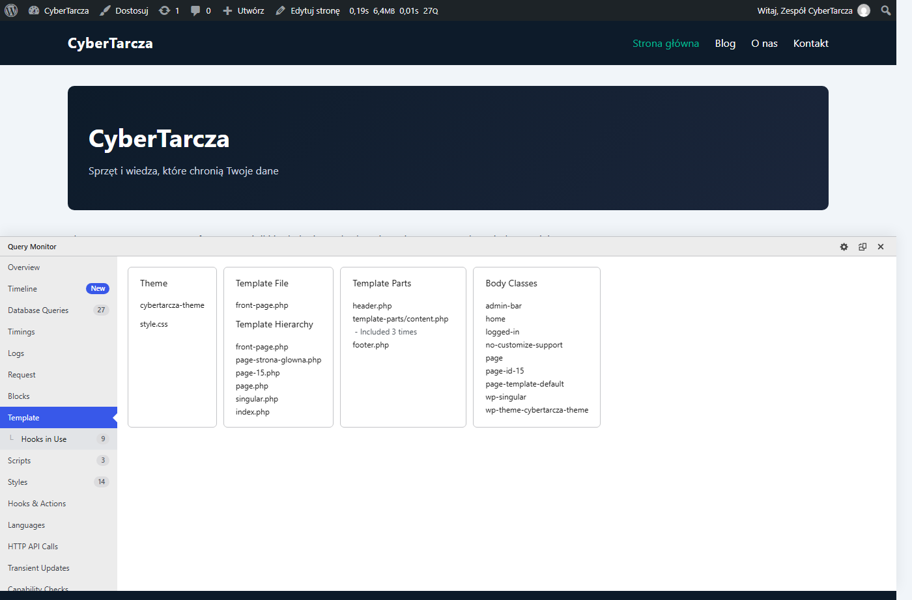
*Rys. 20. Strona główna: hero, treść strony, 3 ostatnie wpisy (WP_Query), widgety i menu w stopce*

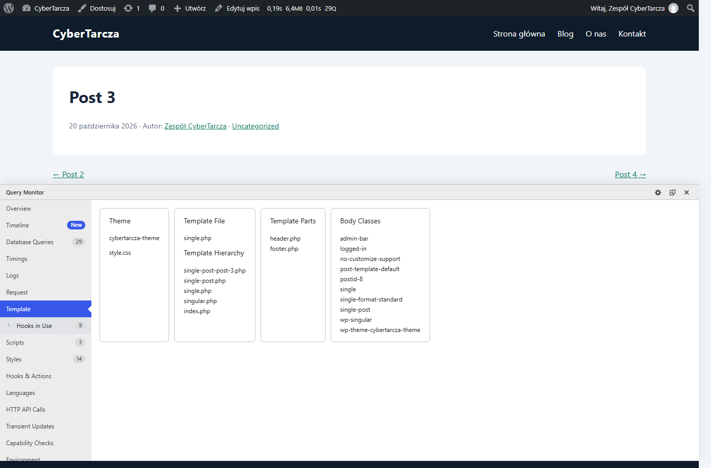
*Rys. 21. single.php: tytuł, data, autor, kategoria, nawigacja między wpisami*

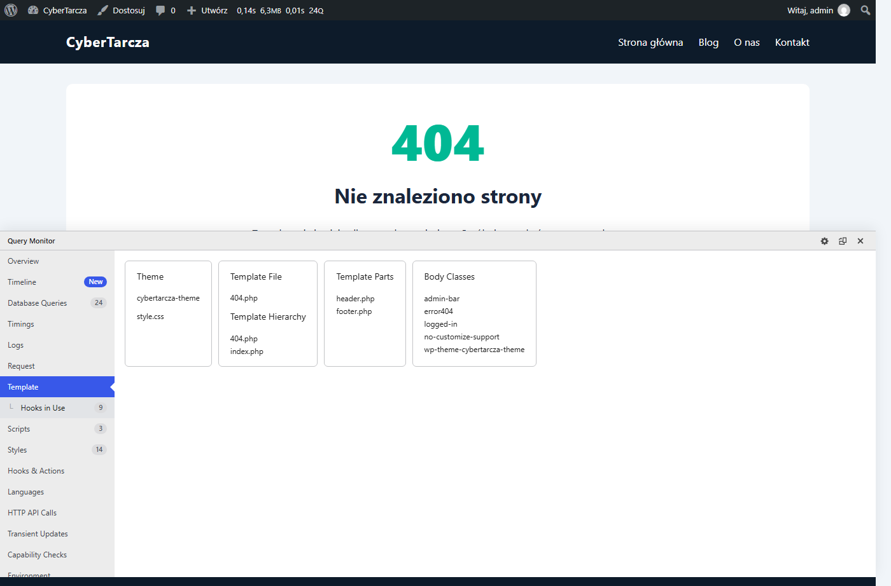
*Rys. 22. 404.php: komunikat, wyszukiwarka, powrót na stronę główną*

---

## 3. Wireframe'y sklepu

Na pomarańczowo (linia przerywana) zaznaczono elementy, które **będzie edytował klient przez pola ACF** (zajęcia 2). Na niebiesko są dane z WooCommerce, a na szaro stałe elementy motywu.

**Pola ACF na stronie głównej:** hero (tytuł, podtytuł, obraz, przycisk CTA), atuty sklepu (repeater: ikona + tekst), 3 wyróżnione kategorie, tytuł sekcji bestsellerów, baner promocyjny (tekst, obraz, link, daty), FAQ (repeater). W stopce, przez stronę opcji, edytowalne są dane firmy i linki do social media.

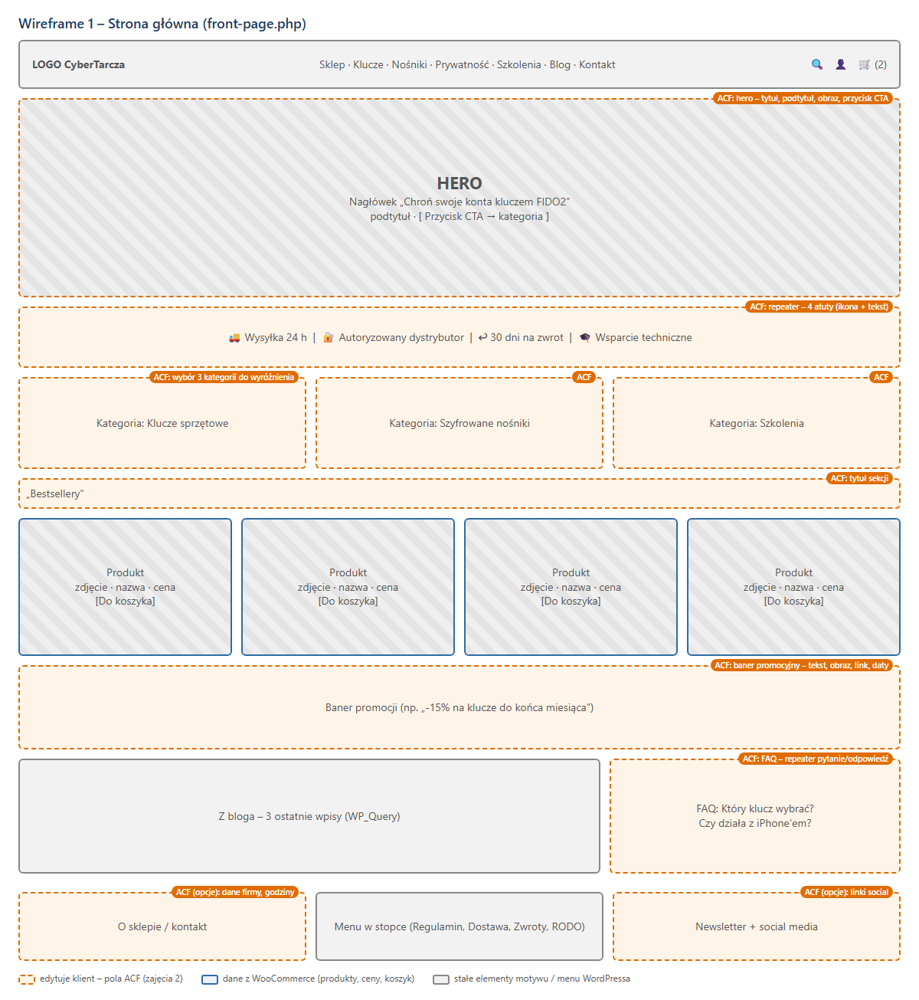
*Rys. 23. Strona główna*

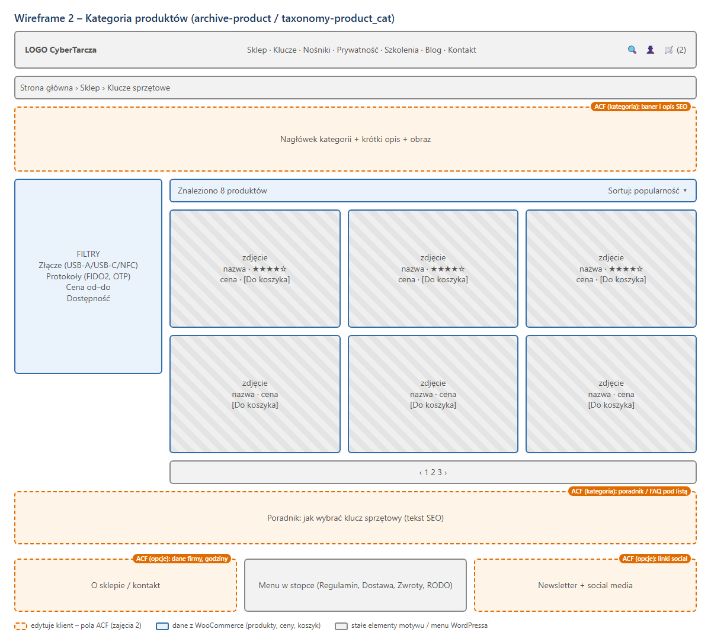
*Rys. 24. Kategoria produktów*

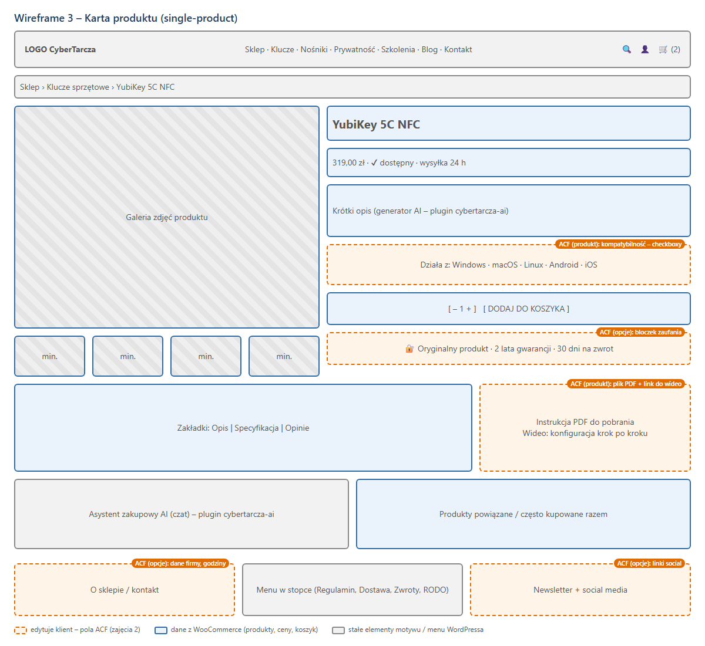
*Rys. 25. Karta produktu*

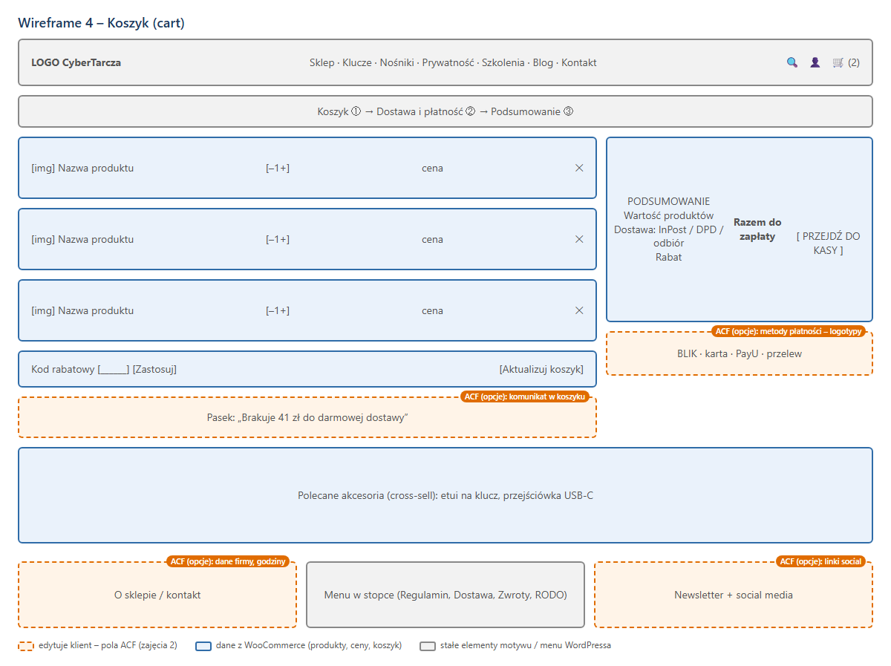
*Rys. 26. Koszyk*

---

## 4. Repozytorium

`wp-content/.gitignore` wpuszcza do repozytorium tylko motyw, dwa pluginy zespołu i katalog `docs/` ze sprawozdaniem. Rdzeń WordPressa, WooCommerce, ACF, Query Monitor, `uploads/` i `debug.log` są ignorowane. Każda osoba klonuje repozytorium do `app/public/wp-content` swojej strony w Local. Stan po zajęciach oznaczono tagiem `lab1`.
